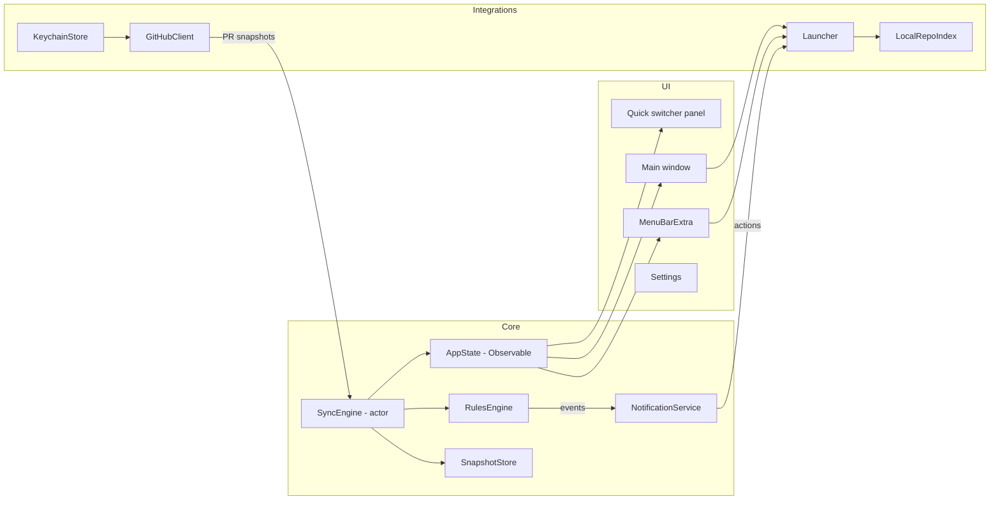

# Architecture

Technical design for Docket v1. Requirements are in the [PRD](PRD.md).

## 1. Platform choices

| Decision | Choice | Reason |
|---|---|---|
| Language and UI | Swift 6, SwiftUI, with AppKit where SwiftUI falls short | Native look, menu bar support, low resource use |
| Minimum OS | macOS 14 | `@Observable`, SwiftData, mature `MenuBarExtra` and `SMAppService` |
| State | Observation framework (`@Observable` models), Swift concurrency (actors, async/await) | Simple data flow without Combine boilerplate |
| Networking | `URLSession` with async/await, hand-written GraphQL queries | No dependency needed for a handful of queries |
| GraphQL types | Codable structs matching the query shape | Apollo iOS is an option if queries multiply; not needed for v1 |
| Persistence | Keychain (token), `UserDefaults` via `@AppStorage` (settings), JSON or SwiftData in Application Support (PR snapshot cache and notification ledger) | Each store fits its data |
| Notifications | `UserNotifications` (`UNUserNotificationCenter`) with categories and actions | System toasts, sounds, Focus integration |
| Launch at login | `ServiceManagement` `SMAppService.mainApp` | Current system API; appears under System Settings, General, Login Items |
| Global shortcut | A small Carbon `RegisterEventHotKey` wrapper with a fixed list of shortcut choices (chosen 2026-10-13) | SwiftUI has no global hotkey API; avoids the only planned dependency |
| Process launching | `Foundation.Process` for `git` and `gh`; `NSWorkspace` and Apple Events for terminal and editor apps | See [Local workspace integration](local-workspace-integration.md) |
| Dependencies | Sparkle, for self-update in release builds (added 2026-11-02; see [design note](design/self-update.md)). Swift Package Manager, pinned to an exact version. | Less to audit and update; Sparkle is the standard Mac updater and safer than writing our own install path |
| Distribution | Local Xcode signing with Apple Development identity, Hardened Runtime on, App Sandbox off | See section 7 |

## 2. Component overview



### 2.1 Modules

Organize as one app target plus a local Swift package with library targets, so core logic is testable without UI.

| Module | Responsibility | Key types |
|---|---|---|
| `GitHubKit` | GraphQL and REST calls, decoding, rate limit tracking | `GitHubClient` (protocol), `LiveGitHubClient`, `PullRequest`, `CheckRun`, `Review`, `RateLimitInfo` |
| `ReviewCore` | Status derivation, rules engine, snapshot diffing, notification ledger | `PRSnapshot`, `PrimaryState`, `Role`, `StatusDeriver`, `RulesEngine`, `PREvent`, `NotificationLedger` |
| `Sync` | Scheduling, adaptive intervals, power and network awareness | `SyncEngine` (actor), `SyncSchedule`, `SystemActivityMonitor` |
| `Workspace` | Local repo discovery, git operations, terminal and editor launching, Claude prompt templates | `LocalRepoIndex`, `GitRunner`, `Launcher`, `TerminalAdapter`, `PromptTemplate` |
| `Persistence` | Keychain, settings, snapshot cache | `KeychainStore`, `SettingsStore`, `SnapshotStore` |
| App target | SwiftUI scenes, views, view models, notification delegate, app lifecycle | `DocketApp`, `AppState`, `InboxView`, `PRDetailView`, `MenuContent` |

## 3. App structure

```swift
@main
struct DocketApp: App {
    @NSApplicationDelegateAdaptor(AppDelegate.self) var appDelegate
    @State private var appState = AppState()

    var body: some Scene {
        MenuBarExtra {
            MenuContent()
                .environment(appState)
        } label: {
            MenuBarLabel(count: appState.attentionCount, severity: appState.worstSeverity)
        }
        .menuBarExtraStyle(.window)   // rich popover (UX option M2)

        Window("Docket", id: "main") {
            MainView()
                .environment(appState)
        }
        .defaultSize(width: 1100, height: 700)

        Window("Compact", id: "compact") {
            AttentionListView()
                .environment(appState)
        }
        .defaultSize(width: 400, height: 600)

        Settings {
            SettingsView()
                .environment(appState)
        }
    }
}
```

- `AppDelegate` sets the `UNUserNotificationCenter` delegate, registers notification categories, handles launch at login state, and switches activation policy between `.regular` (main window open, Dock icon shown) and `.accessory` (menu bar only) when "Hide Dock icon when window is closed" is on.
- Opening the main window from the menu or a notification uses `openWindow(id: "main")` and `NSApp.activate()`.
- Set `LSUIElement` to `NO` in Info.plist and control Dock visibility at runtime, so the app can show the Dock icon while the window is open.

## 4. Data flow

1. `SyncEngine` wakes on its schedule (or on a manual refresh, wake, or reconnect).
2. It runs the discovery searches that are due for their tier, then fetches full detail only for new, changed, or stale PRs (see [GitHub integration](github-integration.md) 2.4). `SyncState` holds every tracked PR's summary and last detail.
3. `StatusDeriver` converts each raw PR into a `PRSnapshot` with role, CI status, review status, merge readiness, and primary state.
4. `RulesEngine.diff(previous:current:)` compares the new snapshots against the last stored set and returns `[PREvent]`.
5. Suppression filters run (actor is me, bots, snoozed, muted, paused, already delivered per `NotificationLedger`).
6. `NotificationService` coalesces events and posts notifications.
7. `SnapshotStore` persists the new snapshot set and ledger atomically.
8. `SyncEngine` publishes the new state to `AppState` on the main actor. Views update.

The rules engine is a pure function over two snapshot sets plus settings. This is the core of the app and gets the most tests.

```swift
struct PRSnapshot: Codable, Hashable, Identifiable {
    let id: String              // GraphQL node ID
    let repo: String            // owner/name
    let number: Int
    let title: String
    let url: URL
    let author: String
    let headRef: String
    let headSha: String
    let baseRef: String
    let isDraft: Bool
    let isCrossRepository: Bool
    let roles: Set<Role>
    let ci: CIStatus
    let checks: [CheckSummary]
    let review: ReviewStatus
    let reviewers: [ReviewerState]
    let merge: MergeReadiness
    let unresolvedThreads: Int
    let primary: PrimaryState
    let stateEnteredAt: Date
    let updatedAt: Date
}

enum PREvent: Hashable {
    case reviewRequested(PRSnapshot)
    case reReviewRequested(PRSnapshot)
    case changesRequested(PRSnapshot, by: [String])
    case ciFailed(PRSnapshot, failing: [CheckSummary])
    case ciRecovered(PRSnapshot)
    case approved(PRSnapshot, by: [String])
    case readyToMerge(PRSnapshot)
    case conflicts(PRSnapshot)
    case newComments(PRSnapshot, count: Int, by: [String])
    case prMerged(PRSnapshot)
}
```

## 5. Persistence

| Data | Store | Notes |
|---|---|---|
| GitHub token | Login keychain, `kSecClassGenericPassword`, service = the app's bundle ID, account = GitHub login | The data protection keychain needs a provisioning profile, which a locally signed build does not have. Login keychain items are not synced to iCloud, and access is tied to the app's code signature. |
| Settings | `UserDefaults` (via `@AppStorage` and a `SettingsStore` wrapper for complex values encoded as JSON) | Poll interval, event toggles and sounds, root folders, repo path overrides, terminal and editor choice, prompt templates, ignored bots, muted repos, shortcut |
| PR snapshot cache | `~/Library/Application Support/Docket/sync-state.json` (`SyncState`: summaries, details, last search runs, rate limit) | Written atomically after each sync; used to diff after restart and to render instantly on launch |
| Notification ledger | Same folder, `ledger.json` | Keys `prID:eventType:headSha` with timestamp; pruned after 30 days |
| Snoozes | Same folder, `snoozes.json` | PR ID, until date or "until change" marker |
| Logs | Unified logging, subsystem = the app's bundle ID | Use `privacy: .private` for anything user-specific |

SwiftData is a reasonable alternative to JSON files if querying cached PRs becomes useful (for example, history and turnaround stats). JSON is simpler for v1.

## 6. Concurrency

- `SyncEngine` is an actor; only one sync runs at a time. A manual refresh during a sync is coalesced into a follow-up sync.
- `AppState` is `@MainActor @Observable`.
- `GitRunner` runs `git` processes off the main actor with a timeout and captures stdout and stderr.
- Cancellation: a sync in flight is cancelled on sleep and on sign-out.

## 7. Signing, sandbox, and entitlements

| Setting | Value | Reason |
|---|---|---|
| Signing | `Config/Signing.xcconfig`: ad hoc by default; `Config/Local.xcconfig` (not committed) sets a team, bundle ID prefix, and Apple Development identity | A stable signature keeps Keychain access without prompts after each build |
| Hardened Runtime | On | Good default even for local builds |
| App Sandbox | Off | The app needs to read arbitrary local repo folders, run `git` and `gh`, and launch terminal apps with commands. A sandboxed app cannot do this without heavy workarounds (security-scoped bookmarks per folder, no arbitrary process execution). This is acceptable because the app is not distributed through the App Store. |
| `com.apple.security.automation.apple-events` | Yes | Drive Terminal or iTerm2 via AppleScript |
| `NSAppleEventsUsageDescription` | "Docket opens your terminal at a repository and starts commands such as Claude Code." | Shown in the macOS permission prompt |
| Network | Outgoing HTTPS to `api.github.com` only | No inbound listeners |

If prebuilt binaries are ever distributed, sign them with a Developer ID certificate and notarize it, so Gatekeeper accepts it on other machines.

## 8. Notifications implementation

- Request authorization on first run with `.alert`, `.sound`, `.badge`.
- Register categories per event type with actions (`UNNotificationAction`) such as `OPEN_GITHUB`, `OPEN_APP`, `START_CLAUDE`, `SNOOZE_1H`. Use `.foreground` option for actions that open apps.
- `userInfo` carries the PR node ID and repo; the delegate resolves the PR from `AppState` and runs the action.
- `threadIdentifier` is the repo name so Notification Center groups per repo.
- Custom sounds: bundle short `.caf` files and reference them with `UNNotificationSound(named:)`.
- Time-sensitive interruption level would let review requests break through some Focus modes, but needs an extra entitlement. Leave it out of v1 and revisit.

## 9. Menu bar implementation

- `MenuBarExtra` with `.window` style gives a rich SwiftUI popover (lists, status chips, buttons). `.menu` style gives a native NSMenu that is faster to scan but limited to text, images, and submenus.
- The label is a template SF Symbol plus a count (`Text`), with a tinted variant for urgent states. Keep it monochrome by default to match other menu bar items; use color only for "CI failing on my PR" if the user enables it.
- Decision: `.window` style (rich popover). The popover's list view, `AttentionListView`, is shared with the Compact window. The hybrid left-click and right-click option was dropped; it would need `NSStatusItem` instead of `MenuBarExtra`.

## 10. View modes

The main window separates scope (sidebar) from presentation (toolbar). See [UX options](ux-options.md) for the user-facing behavior.

```swift
enum Scope: Hashable, Codable {
    case inbox, mine, reviewing, snoozed
    case repo(String)            // owner/name
}

enum Presentation: String, Codable, CaseIterable {
    case list, board, table
}

@MainActor @Observable
final class BrowserModel {
    var scope: Scope = .inbox
    var presentation: Presentation   // loaded per scope from SettingsStore
    var selection: PRSnapshot.ID?
    var query = SearchQuery()        // free text plus repo:, author:, state:, label: tokens
    var tableSort: [KeyPathComparator<PRRow>] = []
    var showInspector = false

    /// One source of truth for every presentation.
    var visible: [PRSnapshot] { /* scope filter, then query filter, then sort */ }
    var sectionsByState: [PRSection] { /* list groups and board columns */ }
    var sectionsByRepo: [PRSection] { /* table grouping */ }
}
```

- `MainView` is a `NavigationSplitView` with the sidebar and a content area that switches on `presentation`:
  - `.list`: `PRListView` plus `PRDetailView` as the detail column.
  - `.board`: `PRBoardView` (horizontal `ScrollView` of `LazyVStack` columns, one per `PrimaryState` group) with `PRDetailView` in an `.inspector`.
  - `.table`: SwiftUI `Table` bound to `tableSort`, with `PRDetailView` in an `.inspector`.
- All three take the same `BrowserModel`, so selection, search, and filters survive a mode switch. `PRDetailView` is one view used in both the detail column and the inspector.
- Board columns and list groups come from the same `sectionsByState`, so both always agree on what "needs you" means.
- `SettingsStore` keeps `[Scope: Presentation]` and a default presentation.
- Toolbar: a segmented `Picker` for presentation; commands in a View menu with Control-Command-1 to 3, and Option-Command-I for the inspector.

### 10.1 Compact window

- A second `Window` scene with id `compact`, default size about 400 by 600, hosting `AttentionListView`, the same view used in the menu bar popover.
- "Keep on top" sets the hosting `NSWindow.level` to `.floating` (reach it via an `NSViewRepresentable` window accessor or `WindowGroup` window customization APIs where available).
- "Expand" calls `openWindow(id: "main")` and sets `BrowserModel.scope` and `selection` to match.

## 11. Quick switcher

- A borderless `NSPanel` (non-activating, floating) hosting a SwiftUI view, toggled by the global shortcut.
- Fuzzy match over repo names, PR numbers, titles, branch names, and authors.
- Enter opens the PR in the main window; modifier keys trigger actions: Command-Enter opens on GitHub, Option-Enter starts a Claude session, Shift-Enter opens a terminal.

## 12. Testing strategy

| Layer | Approach |
|---|---|
| Status derivation | Table-driven unit tests from JSON fixtures |
| Rules engine | Snapshot sequence tests: given snapshots t0, t1, t2, expect events and suppressions |
| GitHub client | Decoding tests against recorded fixtures; one optional live smoke test behind an env flag |
| Keychain | Integration test that writes, reads, and deletes an item under a test service name |
| Launcher | Unit tests that the command builder escapes untrusted input; manual test for Apple Events |
| UI | SwiftUI previews with fixture data; a few UI tests for menu and main window navigation |

## 13. Project layout

```
Docket/
  Docket.xcodeproj
  Docket/                        # app target
    App/                         # App, AppDelegate, AppState
    Views/
      MenuBar/
      Main/                      # MainView, sidebar, BrowserModel
      List/
      Board/
      Table/
      Compact/                   # AttentionListView, shared with MenuBar
      Detail/
      QuickSwitcher/
      Settings/
    Resources/
      Sounds/
      Assets.xcassets
    Docket.entitlements
    Info.plist
  Packages/
    ReviewKit/
      Package.swift
      Sources/
        GitHubKit/
        ReviewCore/
        Sync/
        Workspace/
        Persistence/
      Tests/
        GitHubKitTests/
        ReviewCoreTests/
        WorkspaceTests/
  docs/
```
